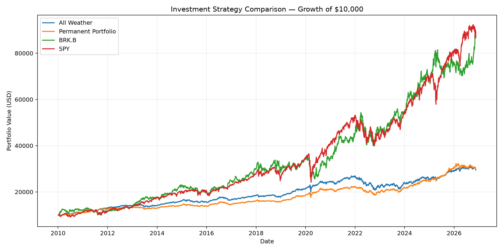

# Investment Strategy Comparative Analysis

**Python backtesting of All Weather, Permanent Portfolio, Berkshire Hathaway, and the S&P 500**

A compact investment research project comparing long-run growth, volatility, drawdowns, and risk-adjusted returns across two diversified asset-allocation strategies and two equity buy-and-hold investments.

## Historical results

*Results copied from the user's completed 2026-11-17 run; future runs can differ as prices and date coverage change.*

| Strategy | Total return | CAGR | Annual volatility | Sharpe (Rf = 0) | Max drawdown |
| --- | ---: | ---: | ---: | ---: | ---: |
| All Weather | 194.74% | 6.62% | 7.88% | 0.85 | -23.03% |
| Permanent Portfolio | 197.84% | 6.68% | **7.08%** | **0.95** | **-17.00%** |
| Berkshire Hathaway (BRK.B) | **786.08%** | **13.81%** | 19.21% | 0.77 | -29.57% |
| S&P 500 (SPY) | 768.14% | 13.67% | 17.06% | 0.84 | -33.72% |

The unrounded values are in [`output_strategy/strategy_metrics.csv`](output_strategy/strategy_metrics.csv). The saved image is from the same user-shared historical run.
### Portfolio Growth Comparison

### Findings

- **Long-term growth:** Berkshire Hathaway narrowly exceeded SPY on CAGR (13.81% versus 13.67%), but had higher annualized volatility (19.21% versus 17.06%) and a lower zero-risk-free Sharpe ratio.
- **Capital preservation:** The Permanent Portfolio proxy had the lowest volatility and smallest maximum drawdown among the four strategies in this sample. Its 6.68% CAGR was substantially below the equity-only alternatives.
- **Risk-adjusted returns:** The Permanent Portfolio proxy had the highest Sharpe ratio (0.95) **under the simplified 0% risk-free-rate assumption**, not necessarily under a time-varying Treasury-bill benchmark.
- **Sensitivity to macroeconomic conditions:** Even diversified portfolios can lose value when both stocks and long-duration bonds decline, such as during rate shocks.

**Interpretation:** This historical comparison illustrates the trade-off between compound growth and diversification. It does not establish that any strategy will outperform in the future, nor does it measure Berkshire's manager-specific alpha.

| File | Purpose |
| --- | --- |
| `strategy_comparison.png` | Growth of $10,000 for four strategies |
| `strategy_metrics.csv` | Total return, CAGR, volatility, Sharpe ratio, max drawdown |
| `daily_portfolio_values.csv` | Daily simulated values (generated when run; not included in GitHub package) |
| `adjusted_prices.csv` | Downloaded adjusted prices (generated when run; not included in GitHub package) |

## Technology

Python · pandas · NumPy · Matplotlib · yfinance

**Educational investment research project. Not financial advice.**
